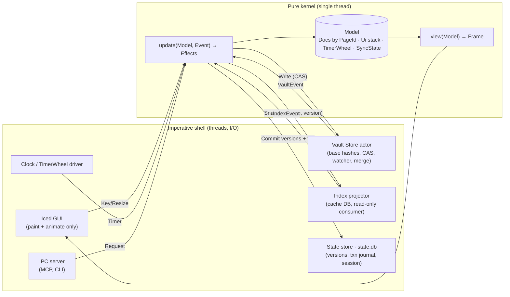

# Bloom from First Principles — Redesign Proposal

> **Status:** Architect proposal, revision 4. Incorporates an independent design review (§15), records the CEO decisions (§14), and adds a self-testing feedback loop (§8). M0 foundations are complete; M1 walking-skeleton work has started on `v2`. Tactical F1/F13 fixes are tracked separately.
> **Scope:** Whole system: persistence, identity, text model, history, input/focus, geometry, index, MCP.
> **Relationship to existing docs:** This proposal *builds on* `ARCHITECTURE.md`, `GOALS.md`, `BLOCK_IDENTITY.md`, `FILE_FORMAT.md`, and `planning/AUTO_MERGE.md`. If its ADRs are accepted, it *supersedes* parts of `planning/UNIFIED_DOCUMENT_LAYER*.md`, `planning/HISTORY_PRODUCTION_HARDENING*.md`, and `planning/UNDO_DELTA*.md` (see §11).

---

## 0. TL;DR

Most of Bloom's bugs fall into about ten **recurring classes**. Each class has the same root cause: the design lets an illegal or inconsistent state exist, and code then has to keep it from happening, one case at a time. This proposal changes the structure so those states cannot be represented:

| # | Law | Bug class it removes |
|---|-----|---------------------|
| L1 | **One writer per fact.** Everything else is a projection, memoized by version. | Stale derived state, missed recomputation |
| L2 | **The filesystem is not a message bus.** One Vault Store tracks the `base` hash of each page. Writes are compare-and-swap (CAS). Edits merge three ways. | Self-write echo, clobbered external edits |
| L3 | **Identity is a value, not a location.** Pages are keyed by `PageId`. A path is just an attribute. | Duplicate buffers, rename breakage |
| L4 | **Block IDs live in the text.** They are hidden atomic tokens in the rope, not a side table, with explicit identity rules per edit. | Undo losing IDs, canonical-text drift |
| L5 | **Focus is a stack.** It is one sum type, not 13 booleans. | Illegal mode combinations, key leaks |
| L6 | **Units are types.** `CharIdx`, `ByteIdx`, `Line`, and `DisplayCol` are distinct; motions respect graphemes. | Byte/char/width confusion |
| L7 | **Functional core, imperative shell.** `update(Model, Event) -> Effects`. Time, I/O, and randomness are injected. | Untestable races, timer busy-loops |
| L8 | **One geometry authority.** The core lays out using injected font metrics; the GUI only paints. | Cursor/wrap drift between core and GUI |
| L9 | **Ordering contracts live inside one entry point.** `update()` always ends with `settle()`. | "Called render before update_layout" |
| L10 | **One incremental parser.** It is checked against a full parse. | Three parsers disagreeing |
| L11 | **All mutations are transactions.** Multi-file changes commit atomically to a journal and recover without blind roll-forward. | Half-applied refactors, MCP side doors |
| L12 | **Three stores, three lifetimes.** The vault is the source of truth, state is durable, and the cache is disposable. | "Derived" index that can't safely be dropped |
| L13 | **The checks are checked too.** Independent oracles, generated journeys, and deliberate fault injection test both the product and our ability to detect its failures. | Unknown combinations, blind spots in the test suite |

Delivery is a **big-bang rewrite in place** on a long-lived branch (D1, §11). The existing e2e and vim tests are ported as the behavioral oracle, and the new core is dogfooded in shadow mode on a vault copy before a gated cutover. A self-testing feedback loop explores beyond those known scenarios and checks whether its detectors can catch representative failures (§8).

---

## 1. CEO intake

### Idea / hypothesis
Bloom's thesis is "write without deciding where; structure emerges." That thesis is right. The implementation has hit diminishing returns: each fix closes one instance of a bug, and the class it belongs to stays open. We want structural guarantees, so whole categories of bugs become impossible.

### Why it may matter
- The git history has 648 commits. Many fixes repeat the same failure modes (§3). That is a design signal, not just an execution problem.
- Upcoming features make these classes worse: Emergence, live views, auto-merge, and MCP agents writing to the vault. Agents and other external writers are exactly where L2, L3, and L11 matter.
- The project is a personal experiment. A clean core makes it cheap to try new ideas.

### Target user or workflow
A single user with one local vault. They write continuously in a Vim-modal editor, sometimes edit the same files in other tools (Obsidian, VS Code, git pull), and increasingly have AI agents reading and writing notes through MCP.

### Constraints / non-negotiables
- Plain Markdown on disk. Files must remain readable and editable without Bloom.
- No data loss, ever (G17). An acknowledged keystroke survives a crash.
- Typing latency comes first. Background work must never block input.
- Keep the Vim-modal feel and the frictionless capture flow.
- Existing vaults must keep working (format migration has to be automatic and reversible).

### Questions for the PM (all resolved by CEO decisions; see §14)
1. Do users need **mirrors** (the same text physically present in several files), or is **editable transclusion** (one source, rendered in several places) enough? (D2)
2. How much does `git log` on the internal history matter, compared with a Bloom-native history UI? (D3)
3. Should Bloom treat external editors as **writers** (three-way merge) or **readers** (lock + warn)? (D4)
4. Is user-authored BQL actually used, or is Agenda plus a few built-in views enough? (D5)

---

## 2. What we keep

These features are what make Bloom Bloom. The redesign keeps all of them, and several get stronger guarantees.

| Feature | Why it's core | Effect of redesign |
|---|---|---|
| Vim-modal editing (`bloom-vim` intent model) | Muscle memory, speed | Keep the intent model. Add differential tests against Neovim |
| Journal-first capture, quick capture | "Don't decide where" | Unchanged. Journal mode becomes *derived* from the doc kind |
| Plain Markdown + YAML frontmatter, stable page `id:` | Local-first, portable | Byte-identical round trip becomes an invariant (I1) |
| Block IDs `^id` + deep links `[[page^block]]` | Fine-grained structure | IDs become first-class tokens (7 chars, D7). Undo is correct by construction |
| Links/backlinks, tags, tasks, Agenda | Emergent structure | Index is a pure projection that also covers unsaved buffers |
| Fuzzy pickers (nucleo), FTS search | Retrieval | Unchanged engine. Search sees what's on screen |
| Time travel / history | Safety net, trust | One version store replaces git + undo-in-cache |
| Live views | Structure on demand | Built on the projection model (L1); optionally authored in BQL (D5) |
| MCP access for agents | AI-native workflow | Goes through the kernel API, so it gets the same guarantees as the UI |

---

## 3. Diagnosis: bug classes, not bugs

### 3.1 Recurring classes from git history

| # | Class | Representative fix commits | Root cause (structural) | Current mitigation | Why the mitigation doesn't scale |
|---|---|---|---|---|---|
| C1 | Self-write echo / multi-writer sync | 33f3594, 49599b6, 202f8b2, 5309620, efa53d6, c45f154, 2702800, 92065c0 | The watcher reports our own writes back to us, and we tell them apart by guessing | `self_write_hashes` (≤8 per path), `pending_write_id`, version matching (`editor/files.rs:24-186`) | Heuristic. Coalesced writes, slow fsync, and fast external edits can each break it. No CAS, so an external edit made between our read and our write is overwritten |
| C2 | Identity by location | 8f751bd, 6f6b112, 5e3c852, 63290c5, 1a317fa | Buffers are keyed by `PageId` but looked up by path (`find_by_path`). Session stores paths (`session.rs:8-19`). Rename handling uses only the `to` path | Ad-hoc dedup at open sites | Every new entry point (MCP, import, rename, restore) has to remember to dedup |
| C3 | Derived state maintained by hand | 107bdb4, 1e0f8c6, 9cbcef9, 5ef2310, 30aa269, 60b4d7b, 17815fb, a1b02d7, 68025ae, 8998d53 | Layout, timers, which-key, and the startup frame are imperative steps the caller must sequence | Comments ("call this before `render()`", `lib.rs:1870`). `next_deadline()` lists each timer by hand (`lib.rs:1781-1811`) | A new timer or a reordered call silently breaks things. See F1 below |
| C4 | Split geometry authority | a457538, e14ab8e, 5b0c727, de7e2ca, 2ac6a4b, 3b4716d, 66330cc, 7381fde, 02ed913, 8809ed8 | Core computes row/col viewports (`render/viewport.rs`). The GUI separately wraps by pixels and scales heading heights (`bloom-gui/src/wrap.rs:24-220`, `layout.rs:20-93`, `draw/pane.rs`) | Patching both sides to agree | Two implementations of one function always drift. Headless tests can't see the GUI's half |
| C5 | Unit confusion | 6672eb5, 82a74c3, 7f06563, 275bbbe | Parser spans are bytes; rope and cursors use chars; parse tree and IDs use lines; there is no grapheme model (`bloom-vim/.../motion.rs:63-80`) | Careful conversions at call sites | `usize` is `usize`. The compiler can't help |
| C6 | Illegal mode combinations | 3694bd5, 6e50b05, 1d870c0, 771c8d3, ebcde65 | At least 13 independent overlay/mode fields on `BloomEditor` (`lib.rs:676-795`). Key routing is a 50-line priority chain (`editor/keys.rs:22-75`). The GUI has its *own* drawer priority (`bloom-gui/src/layout.rs:61-93`) | Ordering in `handle_key` | 2^13 states, of which only a handful are legal. Two priority orders can disagree |
| C7 | Last line / EOF / trailing newline | c81073e, aea95c8, 85732de, a31fbcc, dd4f21a, 9c44d2a | "Is there a final `\n`?" is mixed into the text, not modeled | Per-motion special cases | Every new motion or operator hits it again |
| C8 | Non-atomic multi-step persistence | (session, refactor, disk/index/undo/git ordering) | A logical change touches files, index, undo DB, and git with no transaction | `checkpoint` flush barrier (`files.rs:290-348`), ~90 KB of hardening docs | Correctness depends on protocol discipline across threads |
| C9 | Block-ID lifecycle | 9a69ef1, 1f87e15, c5fe7c7, README "Undo doesn't re-assign block IDs" | IDs are stripped from the rope into a line-keyed side table (`document.rs:647-746`) and patched back by `canonical_text()` (`684-710`). Undo restores text but not the side table | `block_id_history` per undo node | Two parallel histories (text, IDs) that must stay in sync |
| C10 | Test nondeterminism | 831408b (flaky indexer) | Real threads, real clock, real fs in tests | Sleeps / retries | Races are found by luck |

### 3.2 New findings from this review (code reading)

| # | Finding | Evidence | Class |
|---|---|---|---|
| F1 | **Busy loop after journal navigation.** Three seconds after the last journal nav, `next_deadline()` keeps returning a time in the past. `tick()` returns `true` but never clears `journal_nav_at`, so the event loop re-renders with a zero timeout until the user leaves journal mode. | `lib.rs:1804-1809`, `lib.rs:1850-1856`, `event_loop.rs:61-65,146` | C3 |
| F2 | **`render` is not read-only.** It reads the wall clock (`elapsed()`), reads journal files from disk synchronously, and *consumes* state (`pending_clipboard.take()`), so rendering twice is not idempotent | `editor/render.rs:346,562,629,979,991,1005` | C3 / L7 |
| F3 | **The "derived" index holds data that can't be rebuilt.** `undo_tree`, `undo_tree_state`, `retired_block_ids`, and `page_access` live in the same SQLite DB as FTS/links. A full *rebuild* deliberately preserves them (`index/writer.rs:40-51`), but **deleting or corrupting the DB** (the normal recovery for a cache) silently loses undo history, retired-ID safety, and frecency. | `index/schema.rs:60,78,87,104`, `index/indexer.rs:149-178` | C8 / L12 |
| F4 | **Schema migration ignores errors** (`let _ = ALTER TABLE …`). There is no `user_version`. | `index/schema.rs:117-123` | L12 |
| F5 | **Save mutates the buffer** (`ensure_block_ids`) and **reads disk synchronously on the UI thread** to compare. That contradicts ARCHITECTURE's "save should not secretly edit the buffer." | `editor/files.rs:232-280` | C1 / C9 |
| F6 | **MCP writes files directly** with non-atomic `std::fs::write`, bypassing DiskWriter, the index, undo, and history. That contradicts G17. | `bloom-mcp/src/main.rs` (~324, 367, 399, 445) | C1 / C8 |
| F7 | **The block-ID generator is deterministic.** It is xorshift with a fixed seed mixed with the set size and a thread counter. Uniqueness is not a DB constraint (PK is `(block_id, page_id)`). | `bloom-buffer/src/block_id.rs:27-41`, `index/schema.rs:48` | C9 |
| F8 | **The atomic write temp name collides across extensions** (`path.with_extension("tmp")`: `a.md` and `a.txt` both use `a.tmp`), and the parent directory is never fsynced after rename | `bloom-store/src/disk_writer.rs:159-163` | C8 |
| F9 | **Session is written non-atomically** and stores paths plus line/col | `session.rs:8-19` | C2 / C8 |
| F10 | **Index lags the screen.** The indexer reads disk only, so unsaved edits don't appear in search, backlinks, or Agenda | indexer design | L1 |
| F11 | **The parser runs on every edit.** `reconcile_after_text_change` rebuilds the full ParseTree *and* runs the full parser | `document.rs:590-606` | Perf / L10 |
| F12 | **No property, fuzz, or simulation tests exist.** Coverage is e2e (209), lib (70), vim (42) | `Cargo.toml` dev-deps, `crates/*/tests` | C10 |
| F13 | **The vault-wide block-ID collision check is skipped when the known-ID set is empty** (e.g. before the index has loaded) and falls back to the current document only. Combined with F7's fixed seed, a cold-start save can produce an ID that is already used elsewhere in the vault | `editor/files.rs:445-449`, `bloom-buffer/src/block_id.rs:27-41` | C9 |

> F1 is a good example of the whole problem: the deadline and the "has it fired" state are two hand-maintained facts. Under L7 a timer is a value inside a timer wheel, and **firing consumes it**, so this bug cannot be written.

---

## 4. Design laws (the mechanisms)

Each law is stated as **mechanism**, not intent. If a law can't be enforced by types, structure, or an automated checker, it isn't a law.

### L1 — One writer per fact; everything else is a projection
- **Mechanism:** Each piece of state has exactly one owning module that may mutate it. Derived values are computed by `fn derive(&Source) -> Derived` and memoized by `(source_id, version)`. There is no API to set derived state.
- **Examples:** viewport scroll comes from `(cursor, layout)`; journal mode comes from `doc.kind`; dirty comes from `doc.version != sync.base_version`; which-key visibility comes from `(pending_keys, armed timer fired)`.
- **Removes:** C3, F10.

### L2 — The filesystem is not a message bus
- **Mechanism:** A single **Vault Store** actor owns all disk I/O for the vault. For every page it records `base`, the hash of the bytes it last read or wrote. A watcher event becomes a *read and compare*: if `hash(disk) == base`, it's a no-op (whoever wrote it, including us). Otherwise it is an external change. Writes are CAS: `write(page, expected_base, bytes)`.
- **Result:** "Self-write detection" no longer exists as a concept. There is nothing to detect.
- **Removes:** C1, F5's synchronous UI-thread read, F6 (once MCP routes through it).

### L3 — Identity is a value
- **Mechanism:** `HashMap<PageId, Doc>` is the only document table. `path` is a field updated by the Vault Store on rename. All cross-references (session, panes, history, index rows, links) store `PageId` plus `Anchor { block: BlockId, offset }`, never `(path, line, col)`.
- **Removes:** C2, F9.

### L4 — Block IDs live in the text
- **Mechanism:** The rope contains `^k7m2x` exactly as on disk (raw coordinates). The parse tree derives a set of **ID token spans**, and from those a **visible-coordinate projection**. Motions, text objects, and rendering work in visible coordinates; one function, `lower(visible_range) -> raw_range`, translates every edit. That gives:
  - `Pos` is constructed only through `doc.pos(..)`, which snaps out of token spans. A cursor inside an ID **can't be represented**.
  - Each edit operator gets an explicit identity rule (table below). One module owns those rules.
  - Registers hold **typed content**: text plus ID tokens with *provenance* (source page and whether the ID was live at yank time).
  - New-block IDs are generated in the **same transaction and undo step** as the edit that creates the block. Undoing the edit removes the ID, and redo restores the *same* ID.
- **Identity rules (must be prototyped against the Vim suite before ADR-3 is accepted):**

| Operation | Rule |
|---|---|
| `dd` then `p` (move) | ID **preserved**. At paste time the source ID is no longer live, so identity moves with the block and links keep resolving |
| `yy` then `p` (copy) | Pasted block gets a **fresh** ID, because the source is still live. Mirroring, if kept, is an explicit command |
| `J` (join two blocks) | First block's ID survives. The second ID is retired. Links to it are reported in a notification |
| Split block (`i<CR>` mid-block) | Left half keeps the ID; right half gets a fresh ID |
| `x` / `X` / `D` at token boundary | Operates on visible text; the token is never partially deleted |
| Delete the whole block | ID retired (recorded in State, see L12) |
| Visual block, `:s` across a line with a token | Edits are lowered per line; a substitution can't match inside a token unless the pattern opts in to raw mode |
| `.` repeat | Repeats the visible-coordinate edit. Identity rules re-apply |

- **Consequence:** Undo/redo restores IDs *because they are text*. `canonical_text()` becomes `rope.to_string()`. The side table and `block_id_history` are deleted.
- **On-disk format change:** none. Files already contain `^id`.
- **Removes:** C9, F5 (no save-time mutation), F13 (generation always checks the durable known/retired set; see L12).

### L5 — Focus is a stack
```rust
struct Ui { base: BaseView, stack: Vec<Overlay> }   // top of stack receives input
enum Overlay { Picker(Picker), Dialog(Dialog), DatePicker(DatePicker), Wizard(Wizard),
               Search(Search), Completion(Completion), MirrorMenu(MirrorMenu), QuickCapture(Capture) }
trait Component { fn key(&mut self, k: Key, cx: &mut Cx) -> Outcome; fn view(&self, cx: &ViewCx) -> Layer; }
enum Outcome { Consumed, Close(Option<Msg>), Pass }
```
- Rendering paints the stack bottom-up. The GUI has **no** priority logic. Which-key is a property of the keymap trie's pending prefix (state in the vim layer), shown via a timer effect.
- **Removes:** C6, deletes the `keys.rs` priority chain and `bloom-gui/src/layout.rs:61-93` drawer arbitration.

### L6 — Units are types
- `CharIdx`, `ByteIdx`, `LineIdx`, `GraphemeIdx`, `DisplayCol`, `Px`. Conversions go only through the `Doc` (which owns the rope) or `Layout` (which owns metrics). No `From<usize>` in public APIs.
- Motions step by grapheme clusters (`unicode-segmentation`). Width uses `unicode-width` *or* injected font metrics (L8). Never `len()`.
- **Newline model:** a document is a sequence of lines. EOL style (`\n`/`\r\n`), BOM, and "has final newline" are **document properties** (like Vim's `fileformat`/`fixeol`), not characters a motion can land on.
- **Removes:** C5, C7.

### L7 — Functional core, imperative shell
```rust
enum Event  { Key(KeyEvent), Resize(SizePx), Timer(TimerId), Vault(VaultEvent), Index(IndexEvent), Ipc(Request) }
enum Effect { Write { page: PageId, base: Hash, bytes: Arc<str>, txn: TxnId },
              Index(Snapshot), Arm { id: TimerId, at: Instant }, Cancel(TimerId),
              Persist(StateRecord), Reply(ReqId, Response), Quit }
// Model holds Arc<dyn FontMetrics> (injected at startup; GUI impl in prod, fixed monospace in tests).
fn update(m: &mut Model, ev: Event, now: Instant, rng: &mut impl Rng) -> SmallVec<[Effect; 4]>;  // ends with settle()
fn view(m: &Model) -> Frame;                                 // pure: no clock, no I/O, no mutation
```
- The shell (Iced + adapters) executes effects and feeds results back as events. The kernel never touches `std::fs`, `Instant::now()`, or a thread.
- **Timers** live in a `TimerWheel` inside `Model`. `next_deadline()` is `wheel.peek()`, which is derived, not hand-written (fixes F1 by construction). `update` first **drains every timer due at `now`**, whatever event woke it, and a fired timer is removed before its handler runs.
- **Font metrics:** the GUI's implementation may use internal shaping caches. That's acceptable because caching doesn't change outputs. The contract is "same inputs → same measurements," and a test checks it.
- **Payoff:** deterministic simulation testing (§8) with fault injection becomes possible.
- **Removes:** C3, C10, F1, F2.

### L8 — One geometry authority
- The kernel computes `Layout = f(doc.version, width_px, theme, &dyn FontMetrics)`, memoized: line breaks, heading heights, glyph x-positions, cursor rect. The GUI receives positioned runs and rects, and only paints and animates.
- `FontMetrics` is injected. The GUI implements it with the same shaping call it paints with (Iced/cosmic-text). Tests use a deterministic monospace implementation, so **headless e2e tests cover wrapping and heading geometry**.
- **Removes:** C4. Deletes `bloom-gui/src/wrap.rs` and the GUI-side scroll/height logic.

### L9 — Ordering contracts live inside the single entry point
- There is no public `update_layout()`. `update()` is the only way to change the model, and it always ends with `settle(&mut model)`. `settle` brings layout up to date and clamps each pane's scroll so the cursor stays visible. Scroll stays persistent state, so Vim's "the view doesn't jump back" behavior is preserved.
- **Cost control:** layout is cached per pane, per line, keyed by `(line content hash, width, theme)`. `settle` re-lays-out only lines invalidated by the edit, plus whatever enters the viewport. A keypress in a 10k-line page shapes one line, not 10k. The keypress → frame budget (§8) enforces this.
- Callers can't skip or reorder the step, because individual handlers aren't reachable from outside the kernel. `view()` only reads.
- **Removes:** the "update_layout before render" ordering contract (`event_loop.rs:50-55`, `lib.rs:1866-1870`).

### L10 — One incremental parser
- One line-oriented block parser with a bounded re-parse window (up to the enclosing blank line or fence boundary) plus a per-line inline parser. Highlighting, the outline, links, tasks, and block IDs all read the **same** tree.
- A differential property test checks `incremental(edit(doc)) == full_parse(edit(doc))` for random edits.
- **Removes:** three-parser disagreement, F11.

### L11 — All mutations are transactions
```rust
struct Txn { id: TxnId, origin: Origin /* User|Mcp|Refactor|Merge|Restore */,
             edits: Vec<(PageId, Version /*expected*/, Edit)> }
```
- Validate everything, then apply everything to in-memory docs (all or nothing). The result is one undo step per page, tagged with the TxnId.
- **Commit protocol** (the State store is one SQLite DB, so a commit is one SQLite transaction):
  1. `BEGIN` → insert the txn row (`origin`, `{page → expected_disk_hash, target_hash, path_op}`) plus every new version record → `COMMIT`. This is the **durability point**.
  2. The Vault Store applies each file write as a CAS and records per-file `applied` status.
  3. When every file is applied, the txn is marked `done`.
  - **Recovery:** for each file not yet applied, if disk still equals `expected_disk_hash`, apply it. If disk already equals `target_hash`, mark it applied. **Anything else** moves the page to `NeedsResolution` (three-way merge UI). Recovery never rolls forward blindly.
- MCP, refactors (rename page, move block), Agenda toggles, restore-from-history, and merges all go through `Txn`. **There are no side doors.**
- **Removes:** C8, F6.

### L12 — Three stores, three lifetimes

| Store | Contents | Durability rule | On schema mismatch |
|---|---|---|---|
| **Vault** (user's files) | `*.md` | Canonical for content *at rest*. Atomic write + dir fsync. Only the Vault Store writes | N/A (format is stable) |
| **State** (`.bloom/state.db`, one SQLite DB, WAL mode) | Version records (history + undo + crash recovery for edits not yet in the vault), txn journal, path ↔ PageId map, **retired block IDs (monotonic set)**, session, frecency, settings | Durable. Group commit (§5.4). Versioned migrations with tests | Migrate. Never drop |
| **Cache** (`.bloom/cache/index.db`) | FTS, links, tags, tasks, live block-ID map, embeddings | Fully derivable from Vault + State | **Delete and rebuild.** `PRAGMA user_version` |

- Retired block IDs are **not** derivable: history compaction can erase the only version that contained one. They are kept as an explicit, append-only set in State.
- Why SQLite instead of custom log files: atomic multi-page commits, WAL, crash-safety, and tooling for free. A custom CRC log format would be a second system to maintain.
- **Removes:** F3, F4.

---

## 5. Target architecture



### 5.1 Per-page sync state (L2)
Two concerns that are currently mixed get separated: **is the document dirty?** (derived) and **what is happening on disk?** (owned by the Vault Store).

```rust
struct PageSync {
    disk: Disk,                    // last *observed* disk state
    saved_version: Version,        // doc version whose bytes == disk.base
    op: Option<InFlight>,          // at most one owned operation per page at a time
    conflict: Option<Conflict>,
}
enum Disk     { Present { path: PathKey, base: Hash }, Absent { last_base: Hash } }
enum InFlight { Write  { from_version: Version, expected: Hash, target: Hash, txn: TxnId },
                Rename { from: PathKey, to: PathKey, txn: TxnId },
                Delete { expected: Hash, txn: TxnId } }
enum Conflict { Content { theirs: Hash }, DeletedExternally, EditVsDelete, RenamedExternally { to: PathKey } }
// Derived, never stored:  dirty == (doc.version != saved_version)
```
- **Completion can't mark newer edits clean.** A finished write sets `saved_version = from_version`, not the current version. Edits made during the write stay dirty by construction.
- **Watcher events are hints, not truth.** On any event the Vault Store re-reads and hashes the affected paths. Events for a path with an owned `InFlight` operation are **fenced**: they are held until the operation completes, then reconciled with a read. Bloom's own atomic rename therefore never appears as "missing then created."
- **Reconciliation scans** run at startup, on watcher overflow/error, and periodically (cheap: `(size, mtime_ns)` first, hash only on change). This covers dropped events.
- **External change:** if `hash == base`, no-op. If the doc is clean, fast-forward (reload, restore cursor via anchors). If dirty, three-way merge with `base` (from State), `ours`, and `theirs`. A clean merge applies as `Txn { origin: Merge }`; otherwise set `Conflict::Content`.
- **CAS write:** compare `hash(disk) == expected`, then write the temp file, fsync, rename, and fsync the directory, then read back to confirm. Mismatch → merge path. Bloom never writes to a path that is `Absent` without an explicit create op, so a save can't recreate a file someone else deleted (that becomes `EditVsDelete`).
- **Honest limitation:** POSIX and Windows have no atomic compare-and-rename. An external write that lands in the microseconds between our compare and our rename is overwritten, and because Bloom never observed it, Bloom can't recover it. The window is microseconds, compared with today's "any time between load and save." The guarantee is: **we never overwrite content we have observed and not merged** (I9).
- **Temp files:** `.<name>.<random>.bloom-tmp` in the same directory, ignored by the watcher and the index (fixes F8).

### 5.2 Identity (L3)
- `PageId` comes from frontmatter `id:` (already in the format). If a page has no ID, the Vault Store assigns one in a `Txn` at first load, the only place that may happen.
- **PathKey:** paths are normalized once: relative to the vault, with case-folding on case-insensitive volumes and symlinks resolved to their target (links outside the vault are ignored). Hardlinks are unsupported and treated as distinct files. I3 is defined over `PathKey`.
- **Duplicate `id:`** across files (Finder copy, git merge): the State store's path ↔ PageId map knows which path previously owned the ID, and that file keeps it. The newcomer is re-ID'd in a `Txn { origin: Repair }`. If neither file is known, nothing is guessed: the user chooses. Filesystem creation time isn't used, since it's unreliable across copies and syncs.
- **Rename:** the watcher's `(from, to)` pair, or an `Absent` page plus a new file with the same `id:`, updates `path`. No buffer is closed or reopened.

### 5.3 Text model (L4, L6, L10)
- **Rope** (ropey) stays. On top of it the `Doc` owns: `TextProps { eol, bom, final_newline }`, the `ParseTree` (incremental), the ID token spans and visible projection (derived from the parse tree), and the version counter.
- **Block-ID assignment:** universal (D6), as today, but no longer at save (`ensure_block_ids`). IDs are 7 base-36 characters (D7), generated in the edit transaction, drawn from the OS CSPRNG, and checked against live + retired IDs in State, which is always loaded and never "empty because the index hasn't loaded yet" (fixes F7 and F13).
- **Byte-identical round trip (I1)** for valid UTF-8 files with a uniform EOL style: load then save without edits produces identical bytes. **Mixed-EOL** files open normally and are normalized only on the first real edit, with a one-time notification. **Invalid UTF-8** files open read-only with a banner. Property test over a corpus plus fuzzed inputs.

### 5.4 History: one version store (replaces git + SQLite undo-in-cache)
```text
state.db: versions(page_id, version, parent, ts, txn_id, origin, keyframe | delta, cursor_anchor)
          tags(page_id, version, kind: Saved | Checkpoint | Named)
```
- **Undo tree** = an in-memory DAG view over that page's versions. Redo branches are just other children. The existing keyframe-every-50 + delta encoding (`undo.rs:184-329`) carries over.
- **Durability (what "acknowledged" means):** edits are group-committed to `state.db` on idle (≈300 ms after the last keystroke) and a commit is attempted at most every 2 s while typing. A version is not acknowledged as durable until its SQLite transaction commits. The ≤2 s loss bound assumes the process is scheduled and storage completes commits within that interval; on commit failure Bloom must surface degraded durability and must not claim that bound or a successful save. An explicit `:w` forces an immediate commit before the vault write. A keypress never waits on fsync.
- **Save points / checkpoints** = tags. **Crash recovery:** at startup, if a page's latest version is newer than the `Saved` tag that matches disk, offer recovery. This replaces the checkpoint flush barrier (`files.rs:290-348`).
- **Retention:** all versions for 48h, hourly for 30 days, daily afterward. Compaction rewrites keyframes, never touches heads or tags, and never removes retired-ID entries.
- **Git:** becomes optional *export* (`bloom history export --git`), not the storage engine.
- **Migration:** a one-time import of `.index/.git` history and the cache DB's `undo_tree` into `state.db`.

### 5.5 Index pipeline (L1, L12)
- The kernel emits `Snapshot { page_id, version, rope: Arc<Rope> }` (O(1) rope clone) after edits (debounced through a timer effect) and after loads. The index projector parses and writes the cache DB on its own thread.
- **Index ⊇ open buffers:** search, backlinks, and Agenda reflect unsaved text (fixes F10).
- **Convergence (I8):** every row is tagged with `(page_id, version)`; stale snapshots are dropped. After quiescence, the index equals `project(latest versions)`.
- Block-ID uniqueness is a real DB constraint (`UNIQUE(block_id)` on live IDs) from the start, because mirrors are gone (D2).
- Block IDs double as **chunk identity for Emergence embeddings**, which answers EMERGENCE open question 6.

### 5.6 MCP and CLI (L11)
- `bloom-mcp` becomes a thin client that speaks JSON-RPC over a local socket / named pipe to the kernel. If no Bloom instance is running, it starts a **headless kernel** (the same crate, no GUI) that holds the vault lock.
- Agent writes are `Txn { origin: Mcp }`. They are undoable, appear in history attributed to the agent, and merge with in-flight user edits through the same path as external edits.

---

## 6. Architecture decision records (ADRs)

> Each ADR becomes `docs/adr/NNNN-title.md` once accepted. Format: Context → Decision → Alternatives → Consequences → Reversibility.

**ADR-1 · Functional core / imperative shell (L7)**
- *Decision:* the kernel is a pure `update`/`view` pair; all I/O is effects.
- *Alternatives:* (a) keep `BloomEditor` with injected traits only (cheaper, but logic stays entangled with I/O ordering); (b) async runtime (tokio) with actors (adds complexity without fixing ordering).
- *Consequences:* + deterministic simulation, + trivially reproducible bugs (record the event log, replay it). − Effects need an executor; some APIs become two-step (request → event).
- *Reversibility:* high. It's an internal boundary.

**ADR-2 · Vault Store with base tracking + CAS (L2)**
- *Decision:* replace `self_write_hashes`/`pending_write_id` with per-page `base` and the `PageSync` state machine (§5.1).
- *Alternatives:* (a) better heuristics (larger hash ring, mtime): the same class stays open; (b) exclusive file locks: other editors ignore advisory locks, and Windows mandatory locks break Obsidian/VS Code.
- *Consequences:* + the external-edit story becomes principled (merge). − Needs `base` content available for merging, which comes from the State store (ADR-5). That's why the State store is built *before* the Vault Store in §11 (M1).
- *Reversibility:* medium.

**ADR-3 · Inline block IDs with a visible projection (L4), reversing the side-table design**
- *Context:* `UNIFIED_DOCUMENT_LAYER` chose to strip IDs into a side table so motions and edits wouldn't see them. That produced C9.
- *Decision:* IDs stay in the rope. A visible-coordinate projection plus one `lower()` function and the identity-rules table (L4) define all edit behavior. Registers carry ID provenance, so `dd`+`p` moves identity and `yy`+`p` copies with a fresh ID.
- *Alternatives:* (a) keep the side table but version it with the undo tree (more synchronized state, the same class); (b) store IDs out-of-band in a sidecar file (breaks portability and other editors); (c) typed token spans in a parallel structure (an option if the prototype shows hidden-character handling is too leaky, but it brings back a second structure to keep in sync).
- *Consequences:* + undo, redo, and canonical text are correct by construction, + no save-time mutation. − Every motion and operator must go through the projection (enforced by types). Each identity rule needs a property test.
- *Acceptance gate:* a spike implements the projection and the rules table, and the existing vim and e2e suites pass unchanged on ID-bearing documents. If the spike fails, fall back to (c).
- *Reversibility:* high. No on-disk change.

**ADR-4 · PageId-keyed identity (L3)**: low risk, high value. Session format changes (auto-migrated).

**ADR-5 · One version store in `state.db` replaces git + undo-in-cache (§5.4)**
- *Alternatives:* (a) keep git (mature tooling, but commit granularity ≠ undo granularity, slow for per-keystroke deltas, and two histories to reconcile); (b) custom per-page append-only log files (rejected: multi-page atomicity, CRC/compaction, and recovery would all be ours to build and test).
- *Consequences:* + one history for undo, time travel, crash recovery, and merge base, + atomic multi-page commits for free. − Lose free `git log`; mitigated by export. **Accepted (D3).**

**ADR-6 · Three stores, three lifetimes (L12)**: uncontroversial; fixes F3 and F4.

**ADR-7 · Kernel-owned geometry (L8)**
- *Risk:* measuring with one engine and painting with another drifts. *Mitigation:* the GUI's `FontMetrics` implementation calls the same cosmic-text shaping used for painting, and a snapshot test compares kernel cursor rects with painted glyph positions.

**ADR-8 · Focus stack + component dispatch (L5)**: deletes ~2k lines of `keys.rs` routing over time.

**ADR-9 · Single incremental parser (L10)**: keep `BloomMarkdownParser` as the *full-parse oracle* in tests only.

**ADR-10 · Mirroring → editable transclusion**: **accepted (D2).** Existing mirrors are converted by the migrator (§11).
- *Today:* `^=id` replicates text physically across files; promotion/demotion yields `pending_writes`; section mirroring adds more. That is cross-file replicated state with a loop-prevention variant (`MirrorEdit`).
- *Proposal:* one canonical block, embedded elsewhere as `![[page^id]]`, rendered and edited in place; edits route to the source page through a `Txn`.
- *Trade-off:* other editors show the embed syntax instead of the text. Obsidian renders `![[page#^id]]` natively, so the syntax should align with it.

**ADR-11 · MCP via kernel IPC (L11)**: fixes F6; no product trade-off.

**ADR-12 · BQL ships as optional syntax (D5; the architect had recommended deferring it)**
- *Context:* `query/` (~2.7k lines) is in tension with G12, which says users shouldn't have to learn a second mini-language just to search.
- *Decision:* BQL ships in v2 as a user-facing language for live views and power queries. It is **never required**: every search and filter flow (pickers, tag/date/link/task filters) works without it, so G12 stands as written.
- *Consequences:* the PM owns a written language spec (grammar, error messages, examples) before M5. The e2e suite includes "search without BQL" journeys so G12 can't erode silently. BQL compiles to the same projection queries as the built-in views, so there's one engine.

---

## 7. Invariants

Every invariant has a **checker** (`fn check_*(model) -> Result<(), Violation>`) that runs after every `update` in debug builds, in all tests, and in the simulator.

| ID | Invariant | Enforced by | Primary test |
|---|---|---|---|
| I1 | Round trip: `save(load(bytes)) == bytes` for unedited pages that are valid UTF-8 with uniform EOL (others: §5.3) | `TextProps` model | proptest + corpus + fuzz |
| I2 | When the scheduled process and writable storage complete commits within the group-commit window (≤2 s), every older edit is on disk or recoverable from `state.db` after a crash, and no vault file is ever torn; a failed commit is surfaced and never acknowledged as durable | group commit + atomic writes + txn journal (L11) | simulation with crash injection |
| I3 | At most one `Doc` per `PageId`; at most one `PageId` per `PathKey` | `HashMap<PageId, Doc>` + path index owned by Vault Store | type + checker |
| I4 | Live block IDs are unique vault-wide | assignment-time check + `UNIQUE` constraint | proptest on paste/duplicate/merge |
| I5 | `!dirty ⇒ hash(doc.text) == disk.base`, and `disk.base` was the last observed disk hash | `PageSync` (`saved_version`) | simulation |
| I6 | Every `Pos` is on a grapheme boundary, outside ID token spans, within the doc | `Pos` constructor | proptest (random edits + motions) |
| I7 | Exactly one component owns input focus | `Ui { base, stack }` | type |
| I8 | After quiescence, index == `project(latest versions)` | version-tagged rows | simulation + differential |
| I9 | We never overwrite disk content we observed and did not merge | CAS write | simulation with external writer |
| I10 | After `update` returns, no armed timer is due at or before `now` (progress, no busy loop) | `update` drains due timers first; `TimerWheel` consumes on fire | checker (would have caught F1) |
| I11 | `view` is a pure function of `Model` (font metrics are part of the model) | no clock/I/O in kernel crate (lint: deny `std::time::Instant::now`, `std::fs` in `bloom-kernel`) | clippy `disallowed_methods` + render twice and compare |
| I12 | Undo then redo returns the identical rope, IDs included | IDs are text (L4) | proptest |

Make the docs-steward role partly mechanical: a test asserts every `I*` in this table has a `check_` function and at least one test referencing it.

---

## 8. Verification strategy

The test system is itself part of the design. It must do more than replay known bugs: it should explore new combinations, compare behavior against independent models, detect hangs and resource leaks, and prove that its detectors notice representative faults. Automation can discover counterexamples to specified properties; it cannot decide product intent or prove the absence of every unknown bug. Those still require human review and a willingness to revise the properties when evidence contradicts them.

### 8.1 Feedback loop: explore → detect → reproduce → minimize → generalize

1. **Explore combinations.** Generate bounded, stateful journeys that interleave editor operations (edit, undo, pane change, search, save) with environment actions (external write, rename, delayed acknowledgement, duplicate or reordered watcher event, crash, restart). Bias generation toward unexplored state transitions, not only uncovered lines. Start with hand-written scenarios; expand generators with each subsystem.
2. **Detect through independent checks.** Compare incremental behavior with a deliberately simple reference implementation built from the same input but not the same incremental bookkeeping. Examples: incremental index versus full rebuild; UI versus MCP semantic edits; and convergence after duplicate watcher notifications. Add progress watchdogs outside the component being watched: each operation must complete, report failure, or enter an explicit blocked state within a bound. Check bounded queues, retained documents, and memory over repeated open/edit/close cycles.
3. **Prove the detectors have sensitivity.** Maintain a small set of deliberate test-only faults (e.g. accept a stale index result, skip a block-ID uniqueness check, fail to consume a due timer). The matching detector must fail for each fault. Run targeted fault-injection checks in PR CI and broader mutation/fault campaigns nightly; a surviving fault is a test-system regression, not a passing build. Use the curated corpus rather than an arbitrary mutation-score target.
4. **Preserve and minimize counterexamples.** A failing generated journey records its seed and a minimized event sequence, then becomes a deterministic regression case. Group failures by stable signature so a storm of equivalent failures yields one actionable case.
5. **Generalize the fix.** Every escaped bug adds both its minimal reproduction and a broader property, invariant, reference check, or injected fault that would have detected the class. A fix without a stronger detector is incomplete. Human review decides whether the behavior or the expectation was wrong; generators and agents must not silently weaken assertions to make a failure disappear.

**Replay and privacy:** generated tests use synthetic vaults and can be replayed exactly from their fixture plus seed/event log. Production diagnostics are bounded and local: by default they record event kinds, operation IDs, versions, timings, and effect outcomes—not note contents, filenames, clipboard data, or raw keystrokes. Exact capture of real-vault state is a separate, explicit opt-in; its bundle may contain private content and must be reviewed locally before it is shared. A content-free diagnostic report must not be presented as an exact replay.

**Feedback health:** track time to detection, reproducible/minimized counterexamples, recurring failure signatures, explored state transitions, and whether curated injected faults are caught. Review unexplored transitions and detector gaps at every milestone. Seed count and line coverage are supporting signals only; neither proves useful exploration or detector strength.

| Layer | What | Tooling | Runs |
|---|---|---|---|
| Types | L3, L5, L6, I3, I6, I7 | Rust type system, `#[deny(clippy::disallowed_methods)]` | compile |
| Property | I1, I4, I6, I12; incremental == full parse; one test per block-ID identity rule (L4); undo algebra | `proptest` | every PR |
| Differential | Vim motions/operators vs **headless Neovim** (`nvim --embed`) on random key sequences within the supported subset; incremental vs full parser | proptest + msgpack-rpc | nightly + PR smoke |
| **Deterministic simulation** | Whole kernel + Vault Store against `SimFs`, `SimClock`, `SimWatcher`, an external-writer actor, and an MCP-client actor. Faults: crash at any effect boundary, torn temp writes, rename failure, ENOSPC, reordered, dropped, or duplicated watcher events, clock jumps. After each step: all invariant checkers and progress bounds. Failing seed → minimized event log → regression test | Custom harness (FoundationDB / TigerBeetle VOPR style). **Start small:** a dozen hand-written race/crash scenarios first, then stateful randomized journeys once those pass | scenarios + bounded PR seeds; broader seed campaigns nightly |
| Fuzz | Loader, parser, frontmatter, vim keystroke streams | `cargo-fuzz` | nightly |
| E2E (existing) | User journeys via `SimInput` / `TestScreen`, **now including wrap and heading geometry** (L8) | `bloom-test-harness` | every PR |
| Snapshot | Frames, layout, rendered views | `insta` | every PR |
| Performance | Budgets below | `criterion` + CI regression gate (>10% fails) | every PR (smoke), nightly (full) |
| Detector sensitivity | Curated injected faults map to named invariants/properties and must be detected | Test-only fault hooks + targeted mutation checks | every PR (small corpus), nightly (expanded) |

### Performance budgets

| Operation | Budget (p99) | Fixture |
|---|---|---|
| Keypress → frame | < 8 ms | 10k-line page, 3 panes |
| Open page | < 30 ms | 10k-line page |
| Search (FTS + fuzzy) | < 50 ms | 10k pages |
| Cold start to first frame | < 300 ms | 10k-page vault, warm cache |
| Indexing | never blocks input; < 2 s to converge after a 100-page external change | simulation |

---

## 9. Scope triage

| Keep / salvage | Rebuild | Defer | Cut / replace |
|---|---|---|---|
| Rust, Iced 0.14, ropey, crossbeam threads, SQLite + FTS5 as cache, nucleo, Markdown + frontmatter, `bloom-vim` intent model, journal, quick capture, pickers, tags/tasks/Agenda, e2e scenarios (ported) | Identity (L3), sync (L2), block IDs (L4), focus (L5), geometry (L8), parser (L10), history (ADR-5), MCP path (ADR-11), store layout (L12), BQL as optional syntax (D5) | Emergence embeddings (until block identity is stable) | Self-write hash ring, side-table block IDs + `block_id_history`, GUI wrap/drawer arbitration, `update_layout`, git-backed history engine, `^=` mirrors (D2), direct fs writes in MCP |

---

## 10. What we deliberately do **not** change

- **No async runtime.** OS threads + crossbeam is the right model for a single-user desktop app, and L7 removes the reason people reach for one.
- **No CRDT.** One user, one device at a time. Three-way merge with a known base covers external editors and agents. Revisit only if multi-device live sync becomes a goal.
- **No database as source of truth.** Markdown on disk stays canonical. This is what makes Bloom trustworthy.
- **No new GUI framework.** Iced stays. L8 makes the GUI *thinner*, which lowers the cost of ever swapping it.
- **No other on-disk format changes.** The only ones are transclusion replacing mirrors (D2), 7-char block IDs (D7), and the `.bloom/` directory layout (L12). The one-shot migrator applies all three, and they can be reversed from its migration record (§11).

---

## 11. Delivery plan: rewrite in place (D1)

**Decision (D1):** a big-bang rewrite on a long-lived `v2` branch of this repo, replacing the current crates in place. The old app on `main` stays the daily driver until cutover. The review's case for a strangler (keep the oracle, keep dogfooding) still stands as a risk, so this plan buys both back: the oracle is *ported*, and dogfooding starts early in shadow mode.

**Rules of the rewrite**
- **Rewrite the core, salvage the leaves.** New: kernel, Vault Store, State store, text model, index projector, GUI shell. Salvaged after review against the laws: the `bloom-vim` intent model and its tests, `undo.rs` keyframe/delta encoding, parser grammar pieces, nucleo picker scoring, theme, the `planning/AUTO_MERGE.md` merge algorithm, and the Logseq importer. A salvaged module must pass the new lints (L6 unit types, `disallowed_methods`) before it lands.
- **Port the oracle, not the code.** The 209 e2e scenarios and 42 vim tests are behavior specs. A `SimInput`-compatible adapter runs them against the v2 kernel. Each scenario is triaged as *port* (behavior kept), *rewrite* (behavior intentionally changed, e.g. mirrors → transclusion; cite the decision), or *drop* (tests an implementation detail). The triage list is checked in and becomes the parity checklist.
- **`main` is fix-only until cutover.** Only data-loss and crash fixes land on `main`, and each one also adds a scenario to the v2 oracle ("port the test, not the fix"). F1 and F13 get tactical fixes on `main` now, because the old app remains the daily driver for months.
- **Never merge `main` into `v2`.** The code diverges by design; scenarios are the only channel between them.
- **Walking skeleton first.** v2 runs end to end (open → edit → save → crash-recover) before any subsystem goes deep. Integration risk is retired early; depth comes after.
- **Shadow dogfooding.** From M2 on, v2 runs daily against a *copy* of the real vault (re-copied nightly) with invariant checkers on and violations logged. v2 never touches the real vault before cutover.

**Ordering principle:** retire the biggest uncertainty first (integration, then the ADR-3 text-model spike), then data safety, then breadth. The State store still precedes the Vault Store (ADR-2). Sizes are relative (S < M < L); this is a personal project, so calendar estimates would suggest precision we don't have.

**M0 execution backlog:** [M0_GROUND_RULES_TASKS.md](M0_GROUND_RULES_TASKS.md) records the bounded ground-rule tasks, dependencies, and acceptance checks. M0 exit is recorded there; it does not itself authorize product parity work.

**M1 implementation constraints:** [M1_WALKING_SKELETON_RISK_REVIEW.md](M1_WALKING_SKELETON_RISK_REVIEW.md) records the pre-implementation risk review, bounded sequence, and gates for the walking skeleton.

| Milestone | Goal | Deliverables | Exit criteria |
|---|---|---|---|
| **M0 Ground rules** (S) | Make the rules mechanical before code exists | `v2` branch; crate layout (`bloom-kernel`, `bloom-state`, `bloom-vault`, `bloom-text`, `bloom-index`, `bloom-gui`, `bloom-mcp`); lints (`disallowed_methods`, unit newtypes); invariant-checker framework; ports (`Fs`, `Clock`, `Watcher`, `Rng`) + `SimFs`/`SimClock`/`SimWatcher`; e2e adapter + scenario triage list; synthetic replay format; progress watchdog contract; reference-model harness; curated detector-fault corpus; criterion harness with the §8 budgets. CI explicitly targets the rewrite branch from its first commit. **On `main`: tactical F1 and F13 fixes** | CI runs lints, checkers, one simulation journey, the small detector-fault corpus, and budgets against an empty kernel; triage list complete |
| **M1 Walking skeleton** (M) | Retire integration risk | `update`/`settle`/`view` + `TimerWheel`; focus stack with only the editor component; plain rope; `state.db` (WAL, `user_version`, versions, group commit); minimal Vault Store (load, CAS save with unique temp name + dir fsync + readback, `PageSync` without merge); GUI paints kernel layout via `FontMetrics`; bounded local metadata recorder | Open a synthetic vault, edit, save, kill -9, recover, and replay the recorded journey; I2, I5, I9, I10, I11 checkers and external progress watchdog live; keypress budget met |
| **M2 Text model** (L) | Eliminate C5, C7, C9 | **ADR-3 spike first (acceptance gate)**; ID tokens + visible projection + identity rules + typed registers; `TextProps`; grapheme motions; single incremental parser; 7-char ID generation (D7) | I1, I4, I6, I12 green; spike verdict recorded (fallback (c) if it fails); shadow dogfooding starts |
| **M3 Vim** (M) | Muscle-memory parity | Salvaged `bloom-vim` on the projection; ported vim tests; Neovim differential | Vim tests green; differential clean on the supported subset |
| **M4 Sync and transactions** (L) | Eliminate C1, C2, C8 | Watcher fencing; reconciliation scans; three-way merge with base from `state.db` (D4); rename/delete states; multi-page `Txn` + commit/recovery protocol (L11); vault lock; IPC endpoint; `bloom-mcp` over IPC + headless kernel | I3, I5, I9 hold across scenarios and randomized seeds (external-writer, MCP, and crash-injection actors); duplicate/reordered watcher metamorphic checks converge; injected stale-result and missed-timer faults are caught |
| **M5 Index, views, BQL** (L) | Emergent structure on projections | Version-tagged index projector (I8); FTS, tags, tasks, links/backlinks, Agenda; live views; pickers; **BQL as optional user-facing syntax (D5)** from a PM-owned language spec | I8 differential green; every search/filter flow works without BQL (G12); search budget met |
| **M6 Product parity** (L) | Everything the parity checklist requires | Journal, quick capture, transclusion `![[page^id]]` (D2), history UI on `state.db` + git export (D3), remaining overlays as focus-stack components, settings/theme, Logseq import | Every *port*/*rewrite* scenario green; PM-owned user docs updated; tester sign-off |
| **M7 Vault migration + cutover** (M) | Move the real vault safely | One-shot migrator: 5→7-char ID rewrite with every in-vault link rewritten in the same `Txn` (D7); `^=` mirrors → transclusion (D2); git + undo history import into `state.db` (D3); dry-run report; full vault snapshot before applying | Cutover gate below |

**Cutover gate** (all required):
1. Parity checklist: every *port* and *rewrite* scenario green.
2. Simulation: 10k randomized seeds clean; performance budgets met on the 10k-page fixture.
3. Shadow dogfooding: at least two weeks on a nightly vault copy with zero invariant violations and no lost edits.
4. Migrator: the dry run on the real vault is clean, and migrate → reverse (from the migration record) → diff is byte-identical on a copy.
5. Rollback is ready: the pre-migration snapshot and the last `main` binary are kept. Rolling back restores the snapshot after exporting any pages edited in v2 since cutover as Markdown.

**After cutover:** `v2` merges into `main` as a replacement, the old crates are deleted in that merge, and the superseded docs are archived.

**Migration details that need care**
- **ID rewrite (D7):** old 5-char IDs go into the retired set and into an alias table in `state.db`, so references from outside the vault (agent transcripts, copied links) still resolve and get rewritten when next touched. The lengths differ, so old and new ID spaces can't collide.
- **Mirrors → transclusion (D2):** the `^id` original becomes the source, and each `^=id` copy becomes `![[page^id]]`. Copies that have diverged from their source are listed in the dry run; nothing is guessed.
- **History import (D3):** read-only first. `.index/.git` and the old cache DB stay untouched until the user confirms.

**Kill criteria:** if a milestone overruns its relative size by 2×, or the M2 spike fails *and* fallback (c) also fails the acceptance gate, stop and re-plan. If v2 hasn't reached shadow dogfooding by the end of M3, re-evaluate the rewrite against a strangler.

**Bug-escape rule:** every bug found in shadow dogfooding, a user report, or production adds a minimized replayable regression and a generalized detector before the relevant milestone can pass. If the failure cannot be replayed exactly without private content, add a synthetic equivalent and preserve any sensitive capture locally, opt-in only.

**Superseded docs (on cutover):** `planning/UNIFIED_DOCUMENT_LAYER*.md` (block-ID side table → ADR-3), `planning/HISTORY_PRODUCTION_HARDENING*.md` (→ ADR-5), `planning/UNDO_DELTA_PERSISTENCE.md` (→ version store). Archive them with a header pointing to the ADRs rather than deleting them.

---

## 12. Risks of this redesign

| Risk | Likelihood | Impact | Mitigation |
|---|---|---|---|
| Second-system effect: the rewrite never ships | High | High | Walking skeleton first (M1); salvage the leaves; explicit cutover gate; kill criteria including "re-evaluate vs strangler if no shadow dogfooding by end of M3"; ADRs are short; SQLite and existing crates over custom formats |
| Months without dogfooding the new core | High | Medium | Shadow dogfooding on a nightly vault copy from M2; ported e2e/vim oracle runs on every PR |
| `main` and `v2` diverge (fixes on `main` never reach v2) | Medium | Medium | `main` is fix-only; every `main` fix adds a v2 scenario; never merge code across |
| Vault migration damages real data (ID rewrite, mirror conversion, history import) | Low | High | Dry-run report; full snapshot before applying; migrate → reverse → diff on a copy is a cutover gate; nothing is guessed on diverged mirrors |
| BQL grows scope or erodes G12 | Medium | Medium | PM-owned language spec before M5; one engine for BQL and built-in views; e2e journeys for search *without* BQL |
| Block-ID identity edge cases (visual block, `J`, `x` at token edge, `:s`, `.` repeat, register provenance) | Medium | High | ADR-3 acceptance-gate spike; identity-rules table (L4) with one property test per rule; fallback option (c) |
| Layout recomputation blows the keypress budget | Medium | Medium | Per-line layout caches keyed by content hash; criterion gate on keypress → frame |
| Font metrics drift between kernel layout and painted glyphs | Medium | Medium | Same shaping call for both; rect-vs-glyph snapshot test |
| `state.db` corruption or unbounded growth | Low | High | SQLite WAL + `integrity_check` at startup; retention compaction tested in the simulator; git export as escape hatch |
| Group-commit window loses the last ≤2 s of typing on a hard crash | Low | Low | Explicit, documented bound (I2); `:w` forces durability; tune the window from measurements |
| CAS race window (§5.1) | Low | Low–Medium | Documented limitation; post-write readback; reconciliation scans |
| Simulator fidelity (real fs behaves differently) | Medium | Medium | Keep a small real-fs integration suite (Windows + macOS + Linux) for rename/fsync/watcher semantics |
| Generators or reference models share the implementation bug | Medium | High | Keep reference models deliberately simple; use cross-implementation differential and metamorphic checks; inject curated faults and require detector failures |
| Diagnostic replay captures private note content | Low | High | Synthetic fixtures and metadata-only local recorder by default; exact real-state capture opt-in, visibly content-bearing, never uploaded automatically |

---

## 13. Working at staff level on this repo

- **ADRs over long planning docs.** Most decisions fit in one page. Long docs become out of date; ADRs are dated decisions that get superseded explicitly.
- **Executable specs.** Every invariant has a checker and a test (§7). Docs-steward drift checks become partly automatic.
- **Measure whether the laws worked.** Tag fix commits by class (`fix(sync):`, `fix(identity):`, `fix(geometry):` …) and track recurrence per class. Success means **zero recurrences** in the classes a milestone claims to close.
- **Bug reports become seeds.** Every field bug gets reproduced in the simulator before it's fixed, and the seed stays as a regression test.
- **The feedback loop is tested.** Curated injected faults must be caught; every escaped bug adds a minimized reproduction and a broader detector. Track reproducibility and detection latency, not just coverage.
- **Performance is a feature with a budget.** Regressions fail CI, the same as test failures.

---

## 14. CEO decisions

Recorded after review of revision 2. Three decisions (D1, D5, D7) differ from the architect's recommendation; revision 3 replans around them.

| # | Decision | Recommendation | **CEO decision** | Consequence in this doc |
|---|---|---|---|---|
| D1 | Delivery approach: strangler / big-bang rewrite | Strangler | **Big-bang rewrite, in place, on a long-lived branch** | §11 rewritten as M0–M7 with a ported oracle, shadow dogfooding, and a cutover gate; new rewrite risks in §12 |
| D2 | Mirrors vs editable transclusion `![[page^id]]` | Transclusion | **Transclusion; drop `^=` mirrors** | ADR-10 accepted; the migrator converts existing mirrors; `UNIQUE(block_id)` from the start |
| D3 | History engine: version store in `state.db` (+ git export) / keep git + undo-in-cache | Version store | **Version store in `state.db` + git export** | ADR-5 accepted; history import in M7 |
| D4 | External editors: writers (three-way merge) / readers (Bloom wins) | Writers | **Writers, with three-way merge against the stored base** | §5.1 as written; M4 |
| D5 | User-authored BQL: ship / defer / cut | Defer | **Ship as optional syntax.** Search and filters never require it; it's for live views and power queries. G12 stays as written | ADR-12 reversed to "ship, optional"; PM spec before M5 |
| D6 | Block-ID policy: universal / lazy | Universal (weakly held) | **Universal** | §5.3; review counterpoint (lazy reduces noise in other editors) noted and declined |
| D7 | Block-ID length: keep 5 / 7 for new IDs / rewrite all to 7 | 7 for new IDs only | **Rewrite all IDs to 7 chars in a one-time migration** | M7 migrator rewrites IDs and in-vault links in one `Txn`; old IDs are retired and kept as aliases. Rationale for 7: at 300k blocks a new ID collides ~0.5% of the time at 5 chars vs ~0.0004% at 7 |

---

## 15. Review log

Revision 2 incorporates an independent adversarial review of revision 1. It independently confirmed F1 (busy loop). Changes made:

| Review finding | Severity | Resolution |
|---|---|---|
| "Log-before-ack" was undefined; per-page logs can't commit multi-page txns atomically; blind roll-forward could clobber external edits | Blocking | State store is one SQLite DB; explicit commit/recovery protocol with `NeedsResolution` (L11); durability defined as a ≤2 s group-commit bound (§5.4, I2) |
| Sync enum couldn't express edits during a write, renames/deletes, own-rename watcher noise, or dropped events | Blocking | `PageSync` with derived dirtiness, `saved_version = from_version`, typed in-flight ops, watcher fencing, reconciliation scans, delete/rename conflicts (§5.1) |
| Migration dependencies were backwards (merge base and IPC before the stores existed) | Blocking | State store now precedes the Vault Store; history UX moved later (§11; carried into the M0–M7 rewrite plan) |
| "Yank strips IDs" broke `dd`+`p`; operator rules were unspecified | Blocking | Typed registers with provenance; identity-rules table; ADR-3 acceptance-gate spike with fallback (L4, ADR-3) |
| Layout per event could blow the latency budget; due timers could be skipped | Non-blocking | Per-line layout caches; `update` drains due timers first (L7, L9, I10) |
| Retired IDs aren't derivable after compaction | Non-blocking | Explicit monotonic set in State (L12) |
| I1/I3 not checkable as stated (mixed EOL, invalid UTF-8, case-insensitive paths) | Non-blocking | Scoped I1; `PathKey` normalization (§5.2, §5.3) |
| F3 overstated (rebuild preserves those tables); render does more I/O than F2 said | Correction | F2/F3 reworded; the render side-effect inventory feeds the M0 lints (`disallowed_methods`) |
| Too many custom infrastructure bets | Suggestion | SQLite instead of a custom log; simulation starts with hand-written scenarios; D6 counterpoint recorded |

Revision 3 records the CEO decisions in §14. D1 (rewrite instead of strangler), D5 (ship BQL as optional syntax), and D7 (rewrite all IDs to 7 chars) differed from the recommendations, so §0, §9, §10, §11, §12, ADR-10, and ADR-12 were revised to match.

Revision 4 adds L13 and §8.1 after the CEO endorsed making the feedback loop a product-engineering capability: explore novel stateful journeys, use independent checks, test detector sensitivity with deliberate faults, minimize and generalize failures, and protect private note content in diagnostics.
